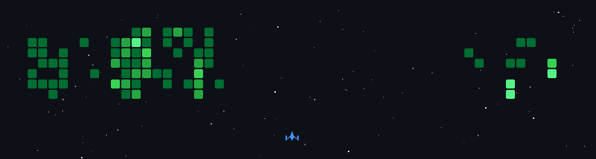

    <h1>Olá 👋</h1>

Meu nome é Davi Gomes Florencio, sou Técnico em Informática pela EEEP Capelão Frei Orlando e Bacharel em Ciência da Computação pela Universidade Federal do Ceará (Campus Quixadá).

Desenvolvedor Mobile Pleno com 5+ anos de experiência na criação, modernização e arquitetura de apps Android nativos, Wearables, iOS e multiplataforma (Kotlin, Jetpack Compose, Kotlin Multiplatform, Java e Flutter/Dart) em larga escala. Aplico MVVM, MVI, Clean Architecture, SOLID e Clean Code, com foco em qualidade (+80% de cobertura de testes), segurança (mTLS/certificate pinning), metodologias ágeis, CI/CD e uso de IA para acelerar entregas. Também tenho vivência em Back-End (Java Spring Boot, WebFlux, Scala, Python), Kafka, Docker/Kubernetes, análise de sinais fisiológicos (NeuroKit) e Teoria dos Grafos.

## 💼 Experiência

- **Desenvolvedor Mobile Android — FCamara (Casas Bahia)** · mar/2026 – atual: migração de RxJava para Coroutines/Flow (+500 arquivos), interoperabilidade XML/Compose, modularização (−40k linhas legadas), migração para Android API 37, testFixtures/Koin, certificate pinning e mTLS.
- **Desenvolvedor Mobile Pleno — Insight Data Science Lab** · mar/2023 – dez/2025: apps Android e Samsung Galaxy Watch (projeto Samsung AI4Wellness) com Kotlin, Compose e KMP, Samsung Health Sensor SDK, 90% de cobertura de testes e análise de sinais com NeuroKit.
- **Desenvolvedor Full Stack — Nex2me** · set/2022 – dez/2022: React, TypeScript, Node.js, PostgreSQL/MongoDB e GitHub Actions.
- **Desenvolvedor Back-End — SSPDS-CE** · mar/2022 – nov/2022: microsserviços com Scala, Spring Boot, WebFlux, Kafka, Docker e Kubernetes.
- **Desenvolvedor Flutter (Estagiário) — NPI UFC Quixadá** · mar/2022 – jul/2022.
- **Monitor de Projeto e Análise de Algoritmos — UFC** · ago/2020 – jan/2022.

## 📊 Seja muito bem vindo(a) ao meu GitHub!

<table>
<tr>
<td>

<!-- <a href="https://next.ossinsight.io/widgets/official/analyze-user-contribution-time-distribution?user_id=20430111&period=all_times" target="_blank" style="display: block" align="center">
  <picture>
    <source media="(prefers-color-scheme: dark)" srcset="https://next.ossinsight.io/widgets/official/analyze-user-contribution-time-distribution/thumbnail.png?user_id=20430111&period=all_times&image_size=auto&color_scheme=dark" width="500" height="auto">
    
  </picture>
</a> -->
</td>
<td>

</td>
</tr>

</table>

<!--  -->

## Stack Principal

<table>
<tr>
  <td>
 <h3> Mobile</h3>

  
  
  
  
  
   
  
  
   
  

  </td>
  <td>
  <h3> Back-end</h3>

  
  
  
  
  
   
  
  
  
  
  
  
  
  
  
  

  </td>
</tr>
</table>

## Tecnologias que tenho conhecimento

  
  
  
  
  
   
  
  
  
  
  
  
  
  
  
  
  
  
 

## Como chegar até mim?

<!--  -->

  
  
  </a>

